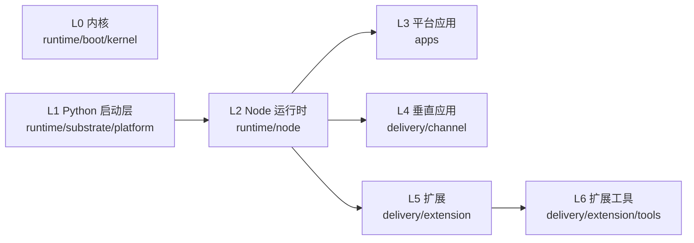

<!-- khy-metadata:auto khy-metadata/4 fingerprint=a16aa572854940ba -->
<!-- 本文件由 khy 机械生成，可被 `khy metadata refresh` 安全覆盖。删除上面这行标记即视为人工接管，刷新将不再覆盖本文件。 -->
# MAP — khy-os 骨架与导航

> 由 khy 自动生成的可维护性种子文档（无需 AI 即可据此维护）。配套 `works/record/ai/CONTEXT.yaml`（契约/符号）`works/record/ai/GUARDS.md`（红线/无AI维护指南）。
> 人工语义层：`works/record/ai/READING-GUIDE.md`（分层图 / 三条链路 / 阅读路线 / 任务反查表）。本文件回答「有什么」，它回答「为什么、读哪个」。
> 本文为确定性扫描产物：目录职责按约定推断，入口/构建命令来自 manifest，符号清单来自轻量正则。带 `TODO(人工)` 处需维护者补全意图。
> 扫描窗口：10464 个文件（上限 20000）。

## 技术栈
`node` · `monorepo` · `python` · `docker` · `docker-compose`

## 核心入口点
- `runtime/substrate/platform/packages/shared/src/index.js` (node-main, workspace:@khy/shared#main)
- `runtime/substrate/platform/packages/ui-shared/src/index.js` (node-main, workspace:@khy/ui-shared#main)
- `runtime/substrate/platform/packages/plugin-sdk/index.js` (node-main, workspace:@khy/plugin-sdk#main)
- `runtime/node/backend/server.js` (node-main, workspace:khy-os-backend#main)
- `runtime/node/backend/bin/khy.js` (cli-bin, workspace:khy-os-backend bin:khyquant)
- `runtime/node/backend/bin/khy.js` (cli-bin, workspace:khy-os-backend bin:khy-os)
- `runtime/node/backend/bin/khy.js` (cli-bin, workspace:khy-os-backend bin:khy)
- `runtime/node/ai-backend/server.js` (node-main, workspace:khy-ai-backend#main)
- `delivery/web/provider-hub/dist/main/index.js` (node-main, workspace:khy-provider-hub#main)
- `delivery/extension/tools/khy-markdown/khyos-md-bridge.js` (node-main, workspace:khyos-markdown#main)
- `delivery/extension/tools/khy-markdown/khyos-md-bridge.js` (cli-bin, workspace:khyos-markdown bin:khyos-markdown)
- `delivery/extension/tools/khy-markdown/khyos-md-bridge.js` (cli-bin, workspace:khyos-markdown bin:khyosmd)

## 分层视图（L0–L6）

> 依赖方向自上而下；L0 内核独立于应用依赖链。名册真源 `scripts/ci/check-repo-layout.js` 的 `LAYERS`。

## 目录结构与职责
- `apps/` — 多应用（401 文件 / 647.0 MB）
  - `apps/khyos-desktop/`
- `delivery/` — 交付层（L4–L6：垂直应用 / 扩展 / 扩展工具）（1652 文件 / 152.3 MB）
  - `delivery/brand/`
  - `delivery/channel/` — 垂直应用载体（L4）
  - `delivery/extension/` — 扩展与交付工具（L5）
  - `delivery/mobile/` — 移动端客户端
  - `delivery/web/` — Web 前端
- `docs/` — 文档（2068 文件 / 56.6 MB）
  - `docs/01_INIT_立项/`
  - `docs/02_CONCEPTS_概念入门/`
  - `docs/03_DESIGN_设计/`
  - `docs/04_IMPL_实现/`
  - `docs/05_TEST_测试/`
  - `docs/06_DEPLOY_部署/`
  - `docs/07_OPS_运维/`
  - `docs/08_MGMT_项目管理/`
  - `docs/09_STORY_修仙学AI/`
  - `docs/10_规范/`
  - `docs/11_报告/`
  - `docs/12_模板/`
- `entries/` — 构建产物单一根（LAYOUT-005）（54 文件 / 140.6 MB）
  - `entries/executables/`
  - `entries/pip/`
  - `entries/tools/` — 工具
  - `entries/workflow-out/`
- `runtime/` — 运行时层（L0–L2：内核 / Python 启动 / Node 业务）（5766 文件 / 50.1 MB）
  - `runtime/boot/` — 引导层（L0）
  - `runtime/node/` — Node 运行时（L2）
  - `runtime/substrate/` — Python 启动层（L1）
- `scripts/` — 脚本（构建/CI/运维）（463 文件 / 4.6 MB）
  - `scripts/admin/`
  - `scripts/backend/` — 后端
  - `scripts/brand/`
  - `scripts/ci/`
  - `scripts/copyright/`
  - `scripts/docs/` — 文档
  - `scripts/evidence/`
  - `scripts/frontend/` — 前端
  - `scripts/hooks/`
  - `scripts/install/`
  - `scripts/lib/` — 库代码
  - `scripts/maintenance/`
- `works/` — 工作区（数据 / 记录 / 打包 / 门禁）（29 文件 / 16.9 MB）
  - `works/deploy/` — 部署
  - `works/patches/`
  - `works/ship/` — 发布物与打包清单
- 根文件: `.clinerules`, `.dockerignore`, `.editorconfig`, `.env.example`, `.gitattributes`, `.gitignore`, `.npmrc`, `.portable`, `AGENTS.md`, `CHANGELOG.md`, `CLAUDE.md`, `Dockerfile`, `KhyOS-Desktop.lnk`, `MANIFEST.in`, `README.md`, `docker-compose.yml`, `fly.staging.toml`, `install-khy.ps1`, `khy-cli.bat`, `khy-env.bat`

## 构建 / 运行 / 测试
- **安装**: `npm install` ; `pip install -e .`
- **测试**: `npm test --workspaces --if-present` ; `pytest`

## 关键文件符号速览
> 导航 teaser（按详略档位裁剪，`KHY_META_DETAIL=brief|standard|full`）。完整逐文件逐符号清单见 `CONTEXT.yaml`。
- `khy.sh` (shell): _无导出符号_
- `portable-setup.sh` (shell): _无导出符号_
- `entries/launch.js` (javascript): fail, printUsage, translate, main
- `scripts/check_builtin_keys.py` (python): array_bytes, decode_arrays, iter_source_files, changed_paths, find_apks, scan_blob, main
- `scripts/findIgnored.js` (javascript): findStandaloneTestFiles
- `scripts/gen_keys.py` (python): keys_file, load_keys, encode, decode, dart_arrays, load_endpoints, camel, _emit, render, check
- `scripts/install-hooks.sh` (shell): _无导出符号_
- `scripts/test-replace.js` (javascript): _无导出符号_
- `apps/khyos-desktop/.build_run.cjs` (javascript): _无导出符号_
- `apps/khyos-desktop/.launch_verify.cjs` (javascript): _无导出符号_
- `apps/khyos-desktop/electron.vite.config.ts` (typescript): _无导出符号_
- `apps/khyos-desktop/vite.config.js` (javascript): _无导出符号_
- `apps/khyos-desktop/vite.host.config.ts` (typescript): _无导出符号_
- `apps/khyos-desktop/vite.scheduler.config.ts` (typescript): _无导出符号_
- `delivery/brand/khy-brand-geometry.js` (javascript): f, polar, a, orient, toPath, ringBladePaths, kSlotPaths, corePath, markParts
- `delivery/brand/khy-brand-wordmark.js` (javascript): _无导出符号_
- `scripts/admin/_check-credentials.js` (javascript): _无导出符号_
- `scripts/admin/_create-admin.js` (javascript): main
- `scripts/admin/_del-creds.js` (javascript): _无导出符号_
- `scripts/admin/_fix-admin.js` (javascript): query, main, loginReq
- `scripts/admin/_insert-user.js` (javascript): main
- `scripts/admin/_insert-user.py` (python): _无导出符号_
- `scripts/admin/_reset-users.py` (python): _无导出符号_
- `scripts/backend/fix-deprecated-encoding.js` (javascript): processFile, fixDeprecatedEncoding
- `scripts/brand/build-brand-assets.js` (javascript): findBrowser, gradientDef, markSvg, MARK_BBOX, appIconSvg, off, faviconMarkSvg, lockupSvg, wordmarkSvg, filingMarkSvg, …(+16)
- `scripts/brand/convert-wordmark-to-outlines.js` (javascript): fail, Ttf, contourToPath, P, f, findFont, main
- `scripts/ci/annotate-patterns.js` (javascript): hasPatternTag, addPatternToJS, addPatternToPython, addPatternToVue, addPatternToC, addPatternToASM, addPatternToShell, addPatternToCSS, addPatternToMoonBit
- `scripts/ci/check-aesthetics.js` (javascript): addFinding, severityFor, readText, changedTouchesRelevant, isIdentifier, isWebToken, isColorToken, collectWebTokens, collectColorTokens, hasIdentifier, …(+16)
- `scripts/ci/check-agent-authz.js` (javascript): add, readText, readJson, checkA2_2_readOnlyProfileHasNoShell, checkA2_2_readOnlyAgentsDenyShell, checkA2_3_noFailOpen, checkA2_1_undeclaredIsNotAllTools, checkA2_4_executionBoundaryEnforcesScope, checkA2_5_singleRoleSet, checkA2_7_noSilentDegradation, …(+1)
- `scripts/ci/check-agent-docs.js` (javascript): findRepoRoot, readBudgets, read, pick, readFilenameTruth, arr, readRootWhitelist, readRootDocExt, readCliTruth, walk, …(+20)
- `scripts/ci/check-agent-feedback.js` (javascript): labelOf, degradeForStage, argValue, detectMode, add, readEvidence, evidenceElsewhere, auditFiveQuestions, isCodePath, isDesignDoc, …(+10)
- `scripts/ci/check-agent-rules.js` (javascript): makeVueTemplateContext, textNodes, attrValues, templateCloses, run, gitUsable, listChangedFiles, shouldIgnore, isSubmoduleGitlink, collectFilesFromTarget, …(+19)
- `apps/khyos-desktop/dist-ts/electron.vite.config.d.ts` (typescript): _无导出符号_
- `apps/khyos-desktop/dist-ts/electron.vite.config.js` (javascript): _无导出符号_
- `apps/khyos-desktop/docs/extract_asar.py` (python): extract_dir
- `apps/khyos-desktop/docs/parse_asar.py` (python): _无导出符号_
- `apps/khyos-desktop/docs/search_all_js.py` (python): _无导出符号_
- `apps/khyos-desktop/docs/search_complete.py` (python): _无导出符号_
- `apps/khyos-desktop/docs/search_context.cjs` (javascript): _无导出符号_
- `apps/khyos-desktop/docs/search_css.py` (python): _无导出符号_
- `apps/khyos-desktop/docs/search_detailed.py` (python): _无导出符号_
- `apps/khyos-desktop/docs/search_detailed2.py` (python): _无导出符号_
- `apps/khyos-desktop/docs/search_final.py` (python): _无导出符号_
- `apps/khyos-desktop/docs/search_intl.py` (python): _无导出符号_
- `apps/khyos-desktop/docs/search_js.py` (python): _无导出符号_
- `apps/khyos-desktop/docs/search_main_js.py` (python): _无导出符号_
- `apps/khyos-desktop/docs/search_mention_ui.py` (python): _无导出符号_
- `delivery/channel/khyquant/setup.py` (python): BuildWithBundle, run, _prune
- …其余 72 个文件的符号见 `CONTEXT.yaml`（完整逐文件清单）。

