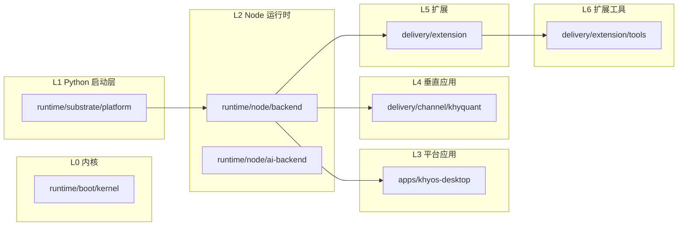
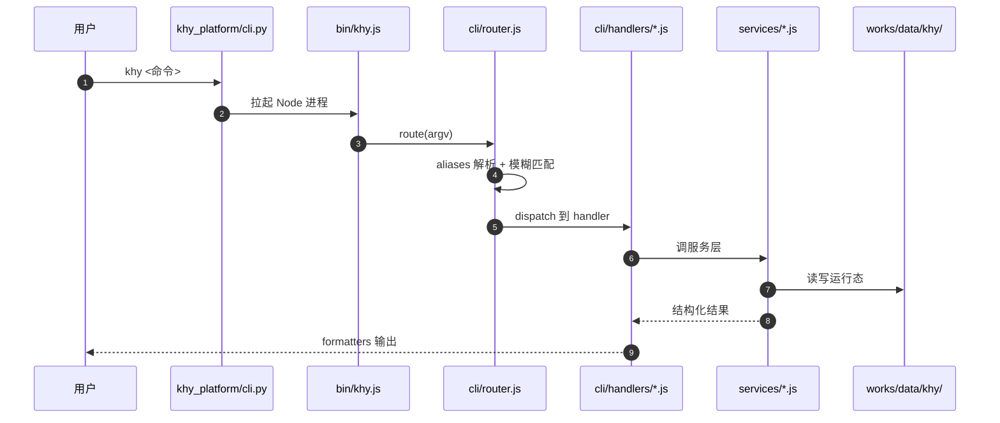
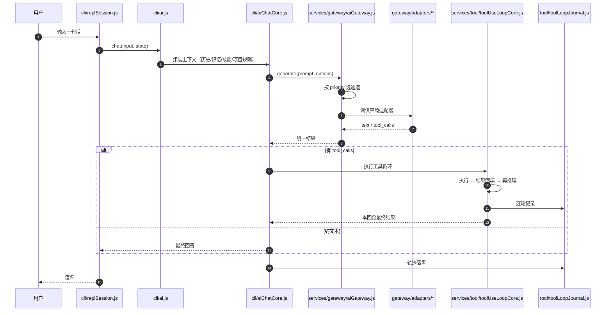
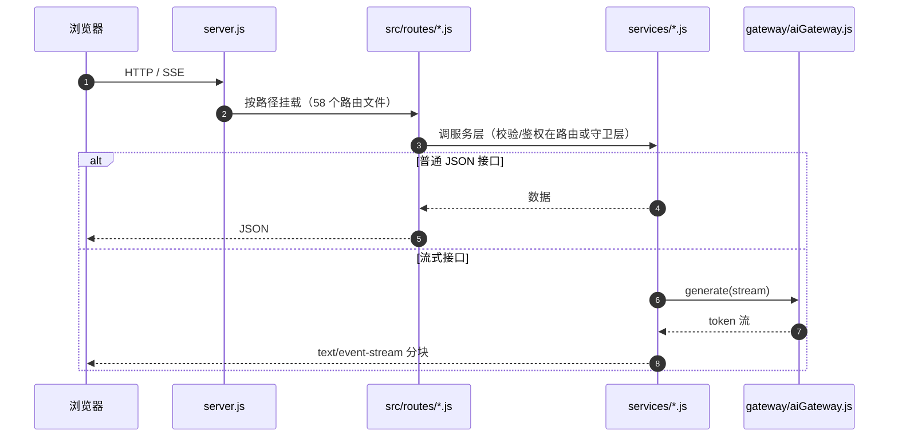
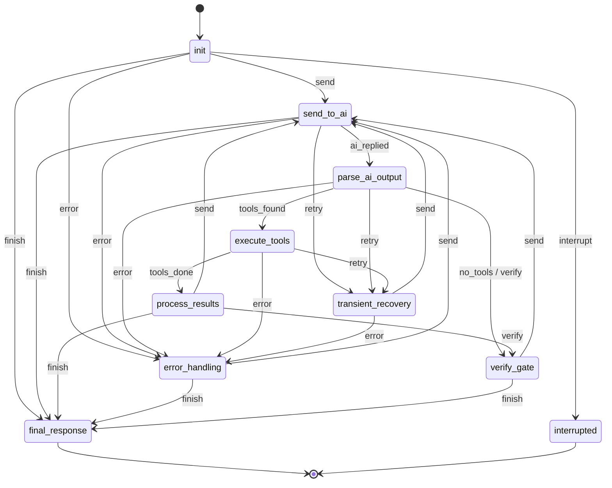
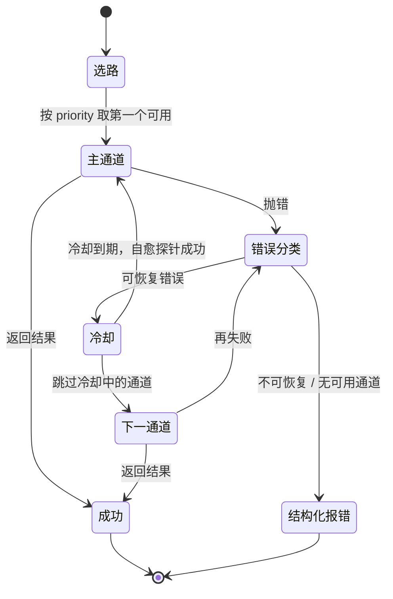

# READING GUIDE — khy-os 可读性手册

> **人工撰写，非生成物；请勿由 `khy metadata refresh` 覆盖。**
> 本文件不带 `khy-metadata:auto` 标记，因此刷新机制只维护 `MAP.md` / `CONTEXT.yaml` / `GUARDS.md`，不会碰这里。
>
> 最后校准：2026-10-27（对应 `MAP.md` fingerprint=`011d5a32ee870ac7`）
> 校准方式：所有路径均用 `Test-Path` 验证存在；所有行数由 `Measure-Object -Line` 实测。

---

## 0. 30 秒版：先看哪一页

| 你现在的问题 | 直接跳到 |
|---|---|
| 这个项目整体长什么样 | §1 分层视图 |
| 哪个目录大、哪个能改、哪个别碰 | §2 规模热力表 |
| 一条命令从输入到落盘经过谁 | §3A 普通 CLI 命令 |
| AI 对话为什么这么绕 | §3B AI 对话链路 |
| 前端请求打到哪 | §3C Web 请求链路 |
| 工具调用循环到底有几个状态 | §4.1 工具循环状态机 |
| 网关为什么换通道、冷却多久 | §4.2 网关选路与降级 |
| 我是新人，30 分钟怎么读 | §5 路线 1 |
| 我要改后端 / 前端 | §5 路线 2 / 路线 3 |
| 我想加个功能，改哪个文件 | §6 任务反查表 |
| `src/services` 里 800 多个文件怎么找 | §7 分桶索引 |

> 一句话：**`MAP.md` 回答「有什么」，本文件回答「为什么这样、该读哪个」。**

---

## 1. 分层视图（L0–L6）



**名册真源**：`scripts/ci/check-repo-layout.js` 的 `LAYERS`（与 `docs/10_规范/DESIGN-LAY/[DESIGN-LAY-005]` 一致）。
`MAP.md` 里那张图由 `projectMetadataService.js` 的 `LAYER_MAP` 渲染，测试 `projectMetadata.test.js` 用对账断言锁死两份 key 集合一致——**改层级必须同时改两边，否则测试红**。

| 层 | 允许做什么 | 明确禁止 |
|---|---|---|
| L0 `runtime/boot/kernel` | 引导、进程生命周期 | 依赖任何应用层 |
| L1 `runtime/substrate/platform` | Python 启动器、拉起 Node、打包辅助 | 承载业务逻辑 |
| L2 `runtime/node` | **全部业务逻辑**：CLI、网关、服务、路由、TUI | 反向 require `scripts/`（跨层） |
| L3 `apps` | 平台自带应用（桌面端） | 被 L2 反向依赖 |
| L4 `delivery/channel` | 垂直应用（khyquant 是独立项目，此处只是分发载体） | 塞回平台内核 |
| L5 `delivery/extension` | 扩展与交付工具 | 直连 L2 内部私有模块 |
| L6 `delivery/extension/tools` | 具体扩展工具 | 同上 |

> ⚠ **最常见误读**：`delivery/channel/khyquant/` 不是 Khy OS 的内置模块。khyquant 是**独立项目**，只是随平台分发/接入；它的著作权、版本、发布节奏都另算。

---

## 2. 规模热力表

> 数字来自 `MAP.md` 的扫描窗口（14,868 个文件 / 上限 20,000），是**扫描到的体积**，不等于安装体积（`node_modules`、`dist` 已被跳过）。
> 阅读档位只有三档：**必读**（入口与链路）、**按需**（出问题才看）、**禁止手改**（生成物/vendor/轨迹）。

| 目录 | 职责 | 文件数 | 体积 | 阅读档位 |
|---|---|---:|---:|---|
| `runtime/node/backend/src` | L2 全部业务逻辑（CLI / 服务 / 路由 / TUI） | 4,190 | — | **必读**（只读核心 10 个文件） |
| `runtime/node/backend/tests` | 后端测试（2,865 个 `.js`） | 2,865 | — | 按需（改哪测哪） |
| `runtime/substrate/platform` | L1 Python 启动器 + 共享包 + 插件 SDK | — | — | 必读 `khy_platform/cli.py` |
| `delivery/web/ai-frontend` | Web 前端（Vue） | — | — | 必读 `src/router` + `src/api` |
| `delivery/channel/khyquant` | 独立项目 khyquant 的分发载体 | — | — | 按需 |
| `delivery/extension` + `tools` | 扩展与扩展工具 | — | 69.3 MB（含 L4） | 按需 |
| `apps/` | 桌面端等平台应用 | 401 | 647.0 MB | 按需 |
| `docs/` | 规范 / 设计 / 报告（**看规则先来这里**） | 2,068 | 56.6 MB | 按需（查真源） |
| `scripts/` | 构建 / CI / 运维脚本（只做路径判断，不 import L2） | 463 | 4.6 MB | 按需 |
| `works/` | 数据 / 记录 / 打包 / 门禁 | 4,959 | 175.7 MB | **禁止手改**（`works/data`、`works/record` 是运行态） |
| `entries/` | 构建产物单一根（LAYOUT-005） | 54 | 140.6 MB | **禁止手改**（可再生） |
| `runtime/` 合计 | L0–L2 | 5,764 | 50.1 MB | — |

### 2.1 三个「看起来像目录、其实不是」

| 路径 | 真相 | 处置 |
|---|---|---|
| `test/` | **空目录**（0 文件）。真实测试在 `runtime/node/backend/tests` | 别在这里找测试；是否删除需走 LAYOUT-004 整理流程 |
| `-p/` | 疑似 npm 参数误建的目录 | 已由 `MAP.md` 标 `TODO(人工)`；确认无引用后按整理流程隔离 |
| `works/record/ai/` | 机器生成的三件套 + 本文件 | **别手改** `MAP.md`/`CONTEXT.yaml`/`GUARDS.md`；本文件例外 |

### 2.2 根目录碎屑（真实存在，不是幻觉）

`$null`、`err_tmp.txt`、`out_tmp.txt`、`m[1])` 等文件出现在 `MAP.md` 的根文件列表里。
它们不影响构建，但会污染「根目录看起来有什么」的判断。清理属 LAYOUT-004（只隔离不删除，留 manifest），**不要顺手 `rm`**。

---

## 3. 三条链路

> 每条链路只回答三个问题：**谁调用我 / 我调用谁 / 我失败了谁兜底**。
> 图中只画主路径；失败分支写在图后的表里。

### 3A. 普通 CLI 命令



| 锚点 | 行数 | 为什么读它 |
|---|---:|---|
| `runtime/substrate/platform/khy_platform/cli.py` | — | Python 侧唯一入口，负责找到并拉起 Node |
| `runtime/node/backend/bin/khy.js` | 2,102 | Node 侧总入口：参数预处理、环境注入、进程生命周期 |
| `runtime/node/backend/src/cli/router.js` | 3,249 | 命令解析 + 别名 + 模糊匹配 + 分派（大 switch） |
| `runtime/node/backend/src/cli/aliases.js` | 768 | 中文/拼音 → 英文命令名映射 |
| `runtime/node/backend/src/cli/handlers/` | 163 个文件 | 每个命令一个 handler（**加命令就在这**） |
| `runtime/node/backend/src/services/` | 705 个平铺 `.js` | 业务逻辑主体 |

**失败兜底**

| 失败点 | 兜底 |
|---|---|
| Python 找不到 Node | `node_provisioner.py` 按平台探测/下载便携 Node |
| 端口被占 | 服务启动时自动探测下一个可用端口（RUNTIME-001 要求） |
| 命令不存在 | 路由器做模糊匹配，给出最接近的命令建议 |
| handler 抛错 | 统一错误格式化；用户可见错误走 `printError()` |

---

### 3B. AI 对话链路



| 锚点 | 行数 | 为什么读它 |
|---|---:|---|
| `runtime/node/backend/src/cli/repl.js` | 130 | 交互入口的稳定门面；重活委托给 `replSession.js` |
| `runtime/node/backend/src/cli/replSession.js` | 13,427 | 会话主循环（历史、快捷键、`/` 命令、渲染节拍）。**只读，不要在这里加新逻辑** |
| `runtime/node/backend/src/cli/ai.js` | 721 | 宿主：把依赖注入 `aiChatCore`，自己不承载聊天逻辑 |
| `runtime/node/backend/src/cli/aiChatCore.js` | 4,821 | 一轮对话的组装：上下文拼装、系统提示、工具接线 |
| `runtime/node/backend/src/services/gateway/aiGateway.js` | 2,510 | 统一网关：优先级选路、错误分类、冷却、降级 |
| `runtime/node/backend/src/services/gateway/adapters/` | 69 个文件 | 每家供应商一个适配器（**加模型供应商就在这**） |
| `runtime/node/backend/src/services/tool/toolUseLoopCore.js` | 10,428 | 工具循环真身：解析 tool_calls、执行、回填、再推理 |
| `runtime/node/backend/src/services/tool/toolLoopJournal.js` | 373 | 每轮轨迹记录，失败可回放 |
| `runtime/node/backend/src/services/domain/state/stateMachine/toolLoopPhases.js` | 127 | 工具循环的**声明式状态机**（§4.1 的源码） |

**失败兜底**

| 失败类型 | 兜底 |
|---|---|
| 限流 / 过载 / 超时 / 网络 / 5xx | 按错误类型进入**通道冷却**，换下一个健康通道（见 §4.2） |
| 模型不存在 | 冷却 30s，并提示用 `/model` 查看可用模型 |
| 空响应 / 输出格式坏 | 进入 `transient_recovery`，重新问一次；仍失败则 `error_handling` |
| 工具执行失败 | 结果回填给模型自纠；连续失败由 `toolLoopDetector` 熔断 |
| 全部通道不可用 | 结构化报错（问题 + 原因 + 修复建议），**不假装成功** |

---

### 3C. Web 请求链路



| 锚点 | 行数 | 为什么读它 |
|---|---:|---|
| `runtime/node/backend/server.js` | 1,670 | Express 装配：中间件、鉴权、路由挂载、端口探测 |
| `runtime/node/backend/src/routes/` | 58 个文件 | 每个领域一个路由文件（`ai.js` / `backtest.js` / `auth.js` …） |
| `delivery/web/ai-frontend/src/api/` | — | 前端 API 客户端（端点必须来自服务发现/env，不得硬编码） |
| `delivery/web/ai-frontend/src/router/` | — | 前端路由 |
| `delivery/web/ai-frontend/src/views/` + `components/` | — | 页面与组件 |
| `delivery/web/ai-frontend/src/stores/` | — | Pinia 状态 |

**流式接口真实存在**：`src/routes/ai.js:407`、`aiGatewayAdmin.js:408/655`、`configSync.js:163`、`wx.js:118` 均含 `text/event-stream`。

**失败兜底**

| 失败点 | 兜底 |
|---|---|
| 后端不可达 | 前端 `backendDiscovery.mjs` / 服务发现降级；必要时回落 CLI 通道 |
| 端口冲突 | 启动时自动探测下一个端口并传播给前端 |
| 流中断 | 前端按 SSE 事件重连；后端保留会话态 |
| 鉴权失败 | 统一 401/403 错误结构，前端跳登录 |

---

## 4. 两个状态机

### 4.1 工具循环状态机（源码级，不是比喻）

真源：`runtime/node/backend/src/services/domain/state/stateMachine/toolLoopPhases.js`。
这是一个**影子观察 FSM**：它不改循环行为，只把真实循环的阶段转换记录下来，用于诊断和轨迹。



**读法**：

1. 主循环是 `send_to_ai → parse_ai_output → execute_tools → process_results → send_to_ai`，这是 AI 能连续调用多个工具的机制。
2. `parse_ai_output → verify_gate` 是**纯文本回复**的路径；`verify_gate → send_to_ai` 是「校验不通过，逼模型再改一轮」的回边。
3. `transient_recovery` 只处理可恢复错误（空响应、格式坏、传输抖动）；恢复不了才进 `error_handling`。
4. `final_response` 与 `interrupted` 是终态，没有出边——**任何「还在转」的循环都不该停在这里**。

> ⚠ 改工具循环前先读 `toolLoopDetector.js`（1,240 行）：它负责识别「模型在原地打转」，是防止死循环的保险丝。

### 4.2 网关选路与降级（阅读用简化模型）

真源：`aiGateway.js` + `aiGatewayRoutingMethods.js` + `aiGatewayCooldownMethods.js` + `autoModelRouting.js`。



**冷却时长**（源码常量，可用 env 覆盖；下限 3–5s）：

| 错误类型 | 默认冷却 | 环境变量 |
|---|---:|---|
| `rate_limit` | 20s | `GATEWAY_RATE_LIMIT_COOLDOWN_MS` |
| `overloaded` | 15s | `GATEWAY_OVERLOADED_COOLDOWN_MS` |
| `server_error` | 15s | `GATEWAY_SERVER_ERROR_COOLDOWN_MS` |
| `network` | 12s | `GATEWAY_NETWORK_COOLDOWN_MS` |
| `timeout` | 10s | `GATEWAY_TIMEOUT_COOLDOWN_MS` |
| `unknown` | 8s | `GATEWAY_UNKNOWN_COOLDOWN_MS` |
| `model_not_found` | 30s | `GATEWAY_MODEL_NOT_FOUND_COOLDOWN_MS` |

**三个容易误判的点**：

1. **冷却不是禁用**。冷却期过后由自愈 ticker 探测恢复；这是「先换路，别死等」而不是「永久拉黑」。
2. **不是所有错误都该重试**。`model_not_found` 冷却 30s，因为重试同一个模型名没有意义。
3. **全败必须诚实**。最终是结构化报错（问题 + 原因 + 修复建议），不允许降级成「看起来成功」。

---

## 5. 三条阅读路线

> 每条路线都按「先骨架、再链路、最后细节」排序。每个文件只写**为什么读 / 读完能答什么**，不写摘要（摘要会过期）。

### 路线 1：新人总览（约 30 分钟）

| # | 文件 | 为什么读 | 读完能回答 |
|---:|---|---|---|
| 1 | `works/record/ai/MAP.md` | 机器眼里的仓库骨架 | 有哪些顶层目录、入口、构建命令 |
| 2 | 本文件 §1–§2 | 分层与规模 | 哪些层能改、哪些目录别碰 |
| 3 | `runtime/substrate/platform/khy_platform/cli.py` | 一切从这里开始 | `khy` 命令怎么拉起 Node |
| 4 | `runtime/node/backend/bin/khy.js` | Node 侧总入口 | 参数、环境、进程怎么初始化 |
| 5 | `runtime/node/backend/src/cli/router.js` | 命令怎么被找到 | 别名、模糊匹配、handler 分派 |
| 6 | `runtime/node/backend/src/cli/handlers/metadata.js` | 一个完整 handler 样例 | 一个命令从解析到输出长什么样 |
| 7 | `runtime/node/backend/src/services/gateway/aiGateway.js` | 产品的心脏之一 | 多供应商怎么选路、怎么降级 |
| 8 | `runtime/node/backend/src/services/tool/toolUseLoopCore.js`（只读前 200 行） | 产品的心脏之二 | 工具调用怎么循环 |
| 9 | `runtime/node/backend/src/services/domain/state/stateMachine/toolLoopPhases.js` | 把循环看成状态机 | 有哪些阶段、哪些是终态 |
| 10 | `delivery/web/ai-frontend/src/api/` + `src/router/` | 前端怎么连后端 | 请求从哪发、端点从哪来 |

### 路线 2：我要改后端（约 2 小时）

| # | 文件 | 为什么读 |
|---:|---|---|
| 1 | `src/cli/router.js` + `src/cli/handlers/<目标命令>.js` | 先确认入口在不在 handler 层 |
| 2 | `src/services/<目标服务>.js` | 业务逻辑主体；顶层 705 个平铺文件，用 §7 定位 |
| 3 | `src/services/tool/toolUseLoopCore.js`（若涉及 AI 工具） | 改工具行为必须理解循环 |
| 4 | `src/services/gateway/aiGateway.js`（若涉及模型） | 改通道必须理解选路与冷却 |
| 5 | `tests/` 下同名测试 | 仓库测试与源码同构，改哪测哪 |
| 6 | `works/data/khy/` | 确认你改的东西落在哪个运行态目录 |
| 7 | `docs/10_规范/` 对应规范 | 改之前先看红线（规则 ID + 守卫） |
| 8 | `scripts/ci/check-agent-rules.js --changed` | 提交前自检硬编码/状态文案/超时/滚动区 |

**改后端的正确顺序**：先找 handler → 再找 service → 改测试 → 跑 `node --test <该测试>` → 跑 `metadata check`。

### 路线 3：我要改前端（约 1.5 小时）

| # | 文件 | 为什么读 |
|---:|---|---|
| 1 | `delivery/web/ai-frontend/src/router/` | 页面从哪进 |
| 2 | `delivery/web/ai-frontend/src/api/` | 后端端点怎么封装（禁止硬编码 host） |
| 3 | `delivery/web/ai-frontend/src/stores/` | 状态放哪、谁在改 |
| 4 | `delivery/web/ai-frontend/src/views/` + `components/` | 页面与组件 |
| 5 | `runtime/node/backend/src/routes/<领域>.js` | 对应后端接口 |
| 6 | `delivery/web/ai-frontend/backendDiscovery.mjs` | 后端不可达时怎么发现/降级 |
| 7 | `delivery/web/ai-frontend/src/composables/` | SSE、轮询等复用逻辑 |

---

## 6. 任务反查表

> 这是本文件最该被用的一节：**「我想…… → 改这里」**。
> 表中「还要改」列的是最容易漏、且漏了会被守卫或测试抓住的地方。

| 我想…… | 主改这里 | 还要改 / 注意 |
|---|---|---|
| 加一个模型供应商 | `src/services/gateway/adapters/`（69 个适配器样板） | 在 `aiGateway.js` 的适配器数组注册；补配置与测试；通道优先级 |
| 加一条 CLI 命令 | `src/cli/handlers/<name>.js` | `src/cli/aliases.js` + `src/cli/router.js`；**命令面棘轮已满（248/245、handler 163/155），必须先退役一条** |
| 加一个 Web 接口 | `src/routes/<domain>.js` | service 实现 + 前端 `src/api/` + 契约测试；端点必须来自服务发现 |
| 改提示词 / 系统提示 | `src/constants/prompts.js` | 跑提示词分类守卫；注意 8,000 字符截断（`instructionFileService.js`） |
| 改工具循环行为 | `src/services/tool/toolUseLoopCore.js`（10,428 行） | 同步看 `toolLoopDetector.js` / `toolLoopJournal.js` / `toolLoopPhases.js`；只读优先 |
| 改网关降级策略 | `src/services/gateway/aiGateway.js` + `aiGatewayCooldownMethods.js` | 错误分类、冷却 env、结构化报错文案 |
| 改 TUI 样式 / 交互 | `src/cli/tui/ink-components/` | 节拍一致性守卫；**不要用 ANSI 滚动区**（RUNTIME-004） |
| 改目录职责 / 地图 | `src/services/projectMetadataService.js` 的 `DIR_ROLES` / `LAYER_MAP` | 同步 `tests/projectMetadata.test.js`；跑 `khy metadata refresh` |
| 改数据落点 | `docs/10_规范/registry/DATA-LOCATIONS.json` | 不要直接往 `works/data/khy/` 根上平铺（已 200+ 项）；跑 `check:data-layout` |
| 加构建产物 | `entries/<producer>/<variant>`（深度 ≤ 2） | 登记 `docs/10_规范/registry/BUILD-OUTPUTS.json`；`.gitignore` 由登记表派生 |
| 改版本号 | `pyproject.toml` + `works/ship/npm/package.json` + `runtime/node/backend/package.json` + `works/ship/modules/modules.json` | 四条轨道**刻意不同**，禁止对齐；MINOR/MAJOR 必须人批准（R-2a） |
| 加一条守卫规则 | `docs/10_规范/registry/RULES-REGISTRY.json` | **规则棘轮 99/94 已满，必须先退役一条**；新机制只能从 S1 观察者起步 |
| 改仓库层级 | `scripts/ci/check-repo-layout.js` 的 `LAYERS` | 同步 `projectMetadataService.js` 的 `LAYER_MAP`（测试会对账） |
| 查某个服务文件在哪 | 本文件 §7 分桶索引 | 用 `Get-ChildItem | findstr` 或 `grep` 按关键词定位 |

---

## 7. `src/services` 分桶索引

> 现状：`runtime/node/backend/src/services` 有 **849 个直接条目**（其中 **705 个平铺 `.js`**、**137 个子目录**、7 个 Python/配置/说明文件）。
> `check-discoverability` 读数 848（差 1 个条目），无论哪个口径，结论相同：**这个目录不能靠「按字母扫」来读**。
>
> **不做物理搬迁**：848 个文件重组会牵动 import、测试、`check:layout`，风险远大于收益。这里改用「索引层」。

### 7.1 真正吸收复杂度的子目录

| 子目录 | 直接条目 | 里面是什么 |
|---|---:|---|
| `gateway/` | 167 | 网关核心 + 69 个供应商适配器 + 选路/冷却/计费 |
| `tool/` | 41 | 工具循环、工具执行、轨迹日志、循环检测 |
| `domain/` | 31 | 领域模型（含 `state/stateMachine/`、`trajectory/`、`eval/`） |
| `crossPlatform/` | 7 | 跨平台适配 |
| `a2a/` | 6 | Agent-to-Agent 协议 |
| `credentialLease/` | 5 | 凭据租约 |
| `entrypoints/` | 4 | 运行入口适配 |
| `reasoning/` | 4 | 推理策略 |
| `__tests__/` | 3 | 服务层测试 |
| `extensions/`、`mcp/`、`skills/` | 各 2 | 扩展 / MCP / 技能包 |
| 其余 120+ 个单文件子目录 | 各 1 | 按主题聚类的单点能力（`memoryEngine/`、`modelRouter/`、`search/`、`security/`…） |

### 7.2 平铺 `.js` 的主题桶（705 个，按文件名关键词归类）

| 主题桶 | 数量 | 代表文件 | 什么时候去这里 |
|---|---:|---|---|
| 其他（跨主题/未归类） | 233 | `accountPool`, `crashRecovery`, `flowPriorityDirective` | 先用 §7.3 的 grep 找 |
| 基础设施 / 服务 | 57 | `a2aMessageRouter`, `adaptiveConfig`, `aiManagementChatHttp` | 端口、路由、配置、消息、日志 |
| 守卫 / 自愈 / 安全 | 57 | `answerEchoGuard`, `approvalLedger`, `authGuard` | 校验、审批、权限、自愈 |
| 工具循环 / 执行 | 56 | `acpTransport`, `adaptiveExecution`, `commandDispatchPort` | 工具调用、shell、沙箱 |
| 任务 / 智能体 | 52 | `a2aAgentLifecycle`, `agentCommunicationService` | agent、任务、目标、编排 |
| 网关 / 模型调用 | 49 | `agnesImageModel`, `aiManagementGatewayAdmin`, `costByModel` | 供应商、模型、计费、限流 |
| 提示词 / 上下文 | 45 | `activeSkillContext`, `agentContext`, `compactionUiPort` | prompt、上下文压缩、轮次 |
| 数据 / 存储 / 文件 | 45 | `aiUploadStore`, `akshareDataService`, `arenaResultStore` | 数据源、存储、文件 |
| 记忆 / 会话 / 检索 | 41 | `aiConversationPort`, `aiSessionPort`, `conversationStore` | 会话、记忆、RAG |
| 终端 UI / 渲染 | 23 | `apiErrorFormatter`, `apiKeyFormat`, `benchmarkSuite` | 格式化、终端渲染 |
| 仓库 / 构建 / 发布 | 20 | `akshareUpdater`, `gitignoreAdvisor`, `gitignoreService` | git、构建、发布 |
| 记录 / 文档 / 审计 | 17 | `auditLog`, `deliveryGateReporter`, `diskAnalyzeReport` | 审计、报告、轨迹 |
| 量化交易 | 10 | `backtestEngine`, `klineDataService`, `marketDataService` | 回测、行情、策略 |

> 口径说明：桶是按**文件名关键词的优先级**归类的，一个文件只进一个桶（前面的桶优先），所以桶之间不重叠；233 个「未归类」是关键词确实没覆盖的，不是错误。

### 7.3 233 个未归类文件怎么找

不要按字母表扫。用「意图词」直接搜文件名：

```powershell
# PowerShell（Windows）
Get-ChildItem runtime/node/backend/src/services -File -Filter *.js |
  Where-Object { $_.Name -match 'daemon|runtime|provision' } |
  Select-Object -ExpandProperty Name
```

```bash
# bash / git bash
ls runtime/node/backend/src/services/*.js | grep -Ei 'daemon|runtime|provision'
```

常用意图 → 关键词：

| 意图 | 关键词 |
|---|---|
| 进程 / 守护 / 启动 | `daemon`, `runtime`, `provision`, `bootstrap`, `launch`, `watchdog` |
| 诊断 / 观测 | `diagnostic`, `telemetry`, `monitor`, `perf`, `attribution` |
| 学习 / 进化 | `learning`, `evolution`, `curriculum`, `selfOptimizer` |
| 媒体 | `image`, `video`, `voice`, `media`, `transcri`, `ocr` |
| 计费 / 订阅 | `subscription`, `billing`, `usage`, `quota`, `account` |
| 恢复 / 回滚 | `recovery`, `rollback`, `rewind`, `resume`, `salvage`, `repair` |

### 7.4 分桶的维护规则

- 新增文件落 `services/` 顶层时，**优先考虑放进已有子目录**（`gateway/`、`tool/`、`domain/`）；
- 如果确实要平铺，文件名必须能表达领域（不要 `helper2.js` / `utils.js`）；
- 本表**不自动生成**，因为它表达的是「人类怎么找」，不是「机器怎么扫」。若桶计数明显失真，更新本表即可，不需要改构建。

---

## 8. 不知道改哪：三步定位法

```text
第 1 步：它是「用户敲的命令」吗？
   是 → src/cli/handlers/ + src/cli/aliases.js + src/cli/router.js
   否 → 第 2 步

第 2 步：它是「模型/通道/工具」相关吗？
   模型/供应商 → src/services/gateway/
   工具循环     → src/services/tool/
   上下文/提示  → src/cli/aiChatCore.js + src/constants/prompts.js
   否 → 第 3 步

第 3 步：它是「Web 接口」吗？
   是 → src/routes/<domain>.js + 前端 src/api/
   否 → 用 §7.3 的关键词在 src/services/ 里搜文件名
```

**最后一道保险**：`node runtime/node/backend/bin/khy.js metadata show` 看机器层的入口点与符号；
`works/record/ai/CONTEXT.yaml` 里有逐文件符号清单（`grep` 它比 `grep` 源码快）。

---

## 9. 这份文档怎么保鲜

本文件**不会被 `khy metadata refresh` 覆盖**，所以它需要三条外部约束：

| 风险 | 约束 |
|---|---|
| 路径被移动/删除 | `node scripts/ci/check-doc-drift.js --changed`（DOCS-005） |
| 命令/路径声称失真 | `node scripts/ci/check-doc-claims.js --changed`（DOCS-006） |
| 目录职责再次漂移 | `MAP.md` 的 `TODO(人工)` + 本文件 §2.1 |

**每次改完架构后，按顺序跑**：

```bash
node runtime/node/backend/bin/khy.js metadata refresh   # 机器层
node runtime/node/backend/bin/khy.js metadata check     # 必须 exit 0
node --test runtime/node/backend/tests/projectMetadata.test.js
node scripts/ci/check-doc-drift.js --changed
node scripts/ci/check-doc-claims.js --changed
```

### 验收清单（可读性的定义）

- [ ] 白板 5 分钟能画出 L0–L6 分层
- [ ] 任抽一条链路，能说出入口 / 关键节点 / 失败兜底
- [ ] 任抽一个「我想改 X」，能在 §6 查到该改哪个文件
- [ ] `metadata refresh` 连跑两次，第二次输出 `结构未变化`
- [ ] 新增顶层目录时，`MAP.md` 出现 `TODO(人工)`，而不是静默消失
- [ ] 新人按路线 1 读完，能独立完成路线 2 的第一个小改动

---

## 10. 送别礼收口记录（2026-10-27）

> 结论：送别礼**不是纪念品**，是一批「能力已存在、但没接线」的补丁。本次收口把「能修的红项」修绿，把「该拦的守卫」接进 CI，把「真休眠的」明确标注，避免再拿文档当已接线。

### 10.1 本次修掉的漂移

| # | 问题 | 改动 | 复核 |
|---|---|---|---|
| 1 | OPS-091 规定前驱块用 `---` 分隔，实现只剩 `\n\n` | `dependencyWaveInjection.js` 补回 `\n\n---\n\n` | `dependencyWaveScheduler.test.js` 37/37 |
| 2 | 两个 flag 守卫读 `src/services/flagRegistry.js`（兼容 shim，不含 flag 表） | 改读 `src/utils/flagRegistry/index.js` | 两套件 8/8、9/9 |
| 3 | `roleToolScope.test.js` 用 jest 全局却没 `require('node:test')`，在 `node --test` 下 0/1 | 补 `node:test` 导入 + 5 个 matcher 的最小 shim | 18/18（其中 live 用例直调 `AgentTool.buildSubagentDenylist`） |
| 4 | `requirementArtifact` 已 compose 但未登记，静默落 protocol 兜底 | `directiveComposer.DIRECTIVE_REGISTRY` 补登记为 `guard` | `directiveRegistryAudit.guard` 7/7、`directiveComposer.test` 19/19 |
| 5 | OPS-077 契约测试仍读 `runtime/tools/khyos-markdown`（已迁到 `delivery/extension/tools/khy-markdown`） | 测试改指新路径 | `mdSuggestedAppsPlan.test` 9/9 |
| 6 | `bundleLaunchContract` 在 Windows 被 Store 的 `python.exe` 别名骗过，探针 9009 假红 | `pythonCommand()` 增加 `--version` 实探 | 16/16（无 Python 时干净跳过） |

### 10.2 新增的 CI 硬门

`pr-gate.yml` 新增 **`gift-guards`** job（无 `continue-on-error`）：

- 后端 10 个套件 **136/136**：波次调度、角色工具作用域、平价守卫、会话修复、任务模板、指令注册、取来即执行、md 建议应用、文件冲突合并、启动失败归因
- `scripts/tests` 11 个套件 **206/206**：还原就绪/完整性/水合/方案/冲突/收敛、渠道启动契约、重复代码检测、症状分诊

在此之前，这些要么只跑在 report-only 的 `test:node`，要么根本没有任何 CI 入口（`scripts/tests/**` 只有手动 `npm run test:scripts`）。

### 10.3 仍然休眠的（不要当成已接线）

| 模块 | 状态 | 裁决 |
|---|---|---|
| `restoreAgentService`（OPS-082 收敛闭环） | 全仓 **0 生产消费者**，也不在维护映射表里；其 7 个叶子被 installer/doctor 直接复用 | 保留代码，文件头标 `DORMANT`；接 CLI/route 前不得宣称闭环可用 |
| `actionContractVerifier` | 0 运行时消费者（设计如此：「未来网关接缝」） | 作为 **CI 安全不变量**存在，34 例 blocking |
| `parityGuard` | 0 生产消费者，但有一条**真 registry + 真 commandSchema** 的 wiring 用例 | 作为 **CI 平价守卫**存在，8 例 blocking |
| `bundleLaunchContract` / `mdSuggestedAppsPlan` | 契约叶子，无运行时调用 | 作为 **CI 契约**存在，16 + 9 例 blocking |

### 10.4 复核命令

```bash
cd runtime/node/backend && node --test \
  tests/services/orchestrator/dependencyWaveScheduler.test.js \
  tests/services/orchestrator/roleToolScope.test.js \
  tests/services/management/parityGuardWiring.test.js \
  tests/services/sessionFileRepairWiring.test.js \
  tests/services/taskTemplateHintWiring.test.js \
  tests/services/directiveRegistryAudit.guard.test.js \
  tests/security/fetchExecuteGuardWiring.test.js \
  tests/services/mdSuggestedAppsPlan.test.js \
  tests/services/orchestrator/mergeFileConflicts.test.js \
  tests/bootstrap/startupFailureExplain.test.js

cd ../../.. && node --test \
  scripts/tests/restoreReadiness.test.js scripts/tests/installIntegrity.test.js \
  scripts/tests/hydrationHealth.test.js scripts/tests/agentRestorePlan.test.js \
  scripts/tests/restoreConflictDetector.test.js scripts/tests/restoreConflictResolver.test.js \
  scripts/tests/restoreConvergenceVerifier.test.js scripts/tests/bundleLaunchContract.test.js \
  scripts/tests/duplicationGuard.test.js scripts/tests/check-duplication.test.js \
  scripts/tests/maintainerTriage.test.js
```

---

## 附录 A：本次校准发现的真实问题

| 问题 | 证据 | 状态 |
|---|---|---|
| `metadata check` 长期 exit 1 | 结构已变更，MAP 指向 6 个不存在的目录 | 已修（生成器 + 重新生成） |
| 扫描上限 4,000 导致 82% 源码不在指纹里 | 4,000 时仅 1,310/7,348 源文件可见 | 已修（默认 20,000） |
| 指针文件写到错误根目录 | `works/record/AGENTS.md` 是 bug 产物 | 机制已修；遗留文件待人工决定是否删（需 `rollback.txt`） |
| `test/` 是空目录 | 0 文件 | 待人工决定是否清理 |
| `-p/` 疑似误建 | `MAP.md` 标 `TODO(人工)` | 待人工确认 |
| 根目录碎屑（`$null`、`err_tmp.txt` 等） | 出现在 MAP 根文件列表 | 待 LAYOUT-004 整理 |
| `src/services` 平铺 705 个 `.js` | `check-discoverability` 报 848 条目 / 上限 40 | 本文件用索引层缓解；物理搬迁单独立项 |

---

## 附录 B：相关真源索引

| 主题 | 真源 |
|---|---|
| 层级名册 L0–L6 | `scripts/ci/check-repo-layout.js` 的 `LAYERS`；`docs/10_规范/DESIGN-LAY/[DESIGN-LAY-005]` |
| 规则登记 | `docs/10_规范/registry/RULES-REGISTRY.json` |
| 数据落点 | `docs/10_规范/registry/DATA-LOCATIONS.json` |
| 构建产物 | `docs/10_规范/registry/BUILD-OUTPUTS.json` |
| 版本真源 | `pyproject.toml`、`works/ship/npm/package.json`、`runtime/node/backend/package.json`、`works/ship/modules/modules.json` |
| 机器骨架 | `works/record/ai/MAP.md` + `CONTEXT.yaml` + `GUARDS.md` |
| 维护红线 | 根 `AGENTS.md` 的「工程规则」节 + `works/record/ai/GUARDS.md` |
